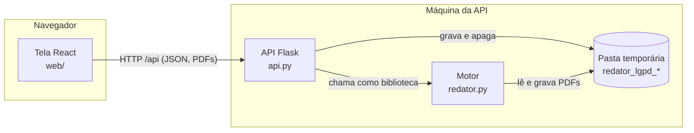

# Arquitetura e tecnologias

## As três partes

| Parte | Arquivo/pasta | Papel |
|---|---|---|
| **Motor** | `redator.py` | Detecção (texto, OCR, códigos), conferência e tarja. Funciona sozinho pela linha de comando. |
| **API** | `api.py` | Recebe os PDFs, organiza a fila, chama o motor, serve as imagens das páginas, aplica a tarja à mão e entrega o tarjado. Também serve a tela compilada (`web/dist`). |
| **Tela** | `web/` | Envio, acompanhamento, conferência e download. React com o design system do ITI (`componentes-react-dafn`). |

Em desenvolvimento, a tela roda no Vite (porta 5173) e repassa as chamadas `/api` para a API (porta 5000). Em uso, a API serve a tela compilada e tudo fica num endereço só.

## Tecnologias e por que cada uma

### Motor e API (Python 3.10 ou mais novo)

| Tecnologia | Para quê | Por que ela |
|---|---|---|
| **PyMuPDF** (MuPDF) | Ler texto com posição de cada caractere, renderizar páginas, aplicar *redaction* e regravar o PDF | É das poucas bibliotecas que fazem tarja destrutiva de verdade (remove texto, zera pixels, remove desenho), e é rápida. |
| **RapidOCR** (`rapidocr-onnxruntime` 1.4.4) com **ONNX Runtime** | OCR de páginas digitalizadas | Instala só com `pip`, sem programa externo como o Tesseract. Os modelos vêm no pacote e rodam na CPU, sem nada sair da máquina. Lê bem português. |
| **OpenCV** (vem com o RapidOCR) | Detectar e decodificar QR Code e código de barras | Leitores prontos e confiáveis; já é dependência do OCR. |
| **NumPy** | Converter a página renderizada em imagem para o OCR e o OpenCV | Padrão para imagem em Python. |
| **Flask** | API HTTP | Pequeno e suficiente para meia dúzia de rotas; sem banco, sem ORM. |
| **Biblioteca padrão** | Fila (`threading`), paralelismo (`concurrent.futures`, processos), pastas temporárias (`tempfile`) | Sem infraestrutura extra (Redis, Celery, banco). |

Dependências em `requirements.txt`. O `--ignore-requires-python` na instalação é porque o RapidOCR declara suporte só até o Python 3.12, mas funciona nos mais novos.

### Tela (Node 20 ou mais novo)

| Tecnologia | Para quê | Por que ela |
|---|---|---|
| **React 19** + **TypeScript** | Interface | Padrão do design system do ITI. A tipagem pega erros de contrato com a API antes de rodar. |
| **Vite** | Servidor de desenvolvimento e build | Recarrega na hora e faz o proxy para a API sem configurar CORS. |
| **Sass (SCSS modules)** | Estilos | Estilos isolados por componente, com as variáveis do design system (inclusive tema escuro). |
| **Design system `componentes-react-dafn`** (`web/src/ui`) | Botões, modais, mensagens, upload, checkbox, accordion | Identidade visual gov.br/ITI pronta e acessível. |
| **axios** | Chamadas à API | Envio de arquivos com `FormData` e tratamento de erro uniforme. |
| **pdf.js** (`pdfjs-dist` 6.5) | Contar as páginas antes de enviar | Roda no navegador, sem enviar nada. Versão 6.2.108 ou mais nova, porque as anteriores executavam JavaScript embutido em PDF malicioso. |
| **Reactour** (`@reactour/tour`) | Tutorial guiado | Destaca cada parte da tela, com passos e saída a qualquer momento. |
| **React Router** e **react-helmet-async** | Rotas e título da aba | |
| **Font Awesome** | Ícones | Já usado pelo design system. |

## Como a API organiza o trabalho

- **Estado em memória.** Os lotes ficam num dicionário em memória (`LOTES`). Não há banco de dados: reiniciar a API perde os lotes em andamento, de propósito.
- **Pasta temporária.** Ao subir, a API cria `%TEMP%\redator_lgpd_<aleatório>`, com uma subpasta por lote. Ao encerrar normalmente, apaga tudo.
- **Uma thread agendadora.** Escolhe o próximo arquivo de todos os lotes pendentes: menos páginas primeiro, descontando 10 páginas por minuto de espera. Processa um arquivo por vez; o paralelismo fica dentro do motor (páginas em paralelo).
- **Cancelamento.** Um `threading.Event` por lote. O motor o consulta 4 vezes por segundo e, quando ligado, encerra os processos de OCR. O agendador então apaga a pasta do lote.
- **Prazo.** O lote concluído fica disponível por 30 minutos, contados de quando ficou pronto. Ver a ressalva em [Limitações](Limitacoes-e-proximos-passos.md#limpeza-dos-lotes-expirados).
- **Tarja à mão.** Uma trava garante uma edição por vez. O PDF é regravado numa cópia (`*.editando.pdf`) e trocado pelo original de forma atômica. A `versao` do arquivo aumenta, e a tela usa isso para buscar a imagem nova da página em vez da que está em cache.

## Como a tela acompanha

- O `LotesContext` guarda os lotes desta aba e consulta a API **a cada 1 segundo** enquanto algum lote está na fila ou processando.
- Os ids dos lotes ficam no `sessionStorage`: um F5 retoma o acompanhamento; fechar a aba encerra.
- A barra **Tarjamentos** fica à direita, entre cabeçalho e rodapé, encaixada por portal (`AreaLateralContext`).

Mais detalhes em [Front-end](Front-end.md) e [Referência da API](Referencia-da-API.md).
