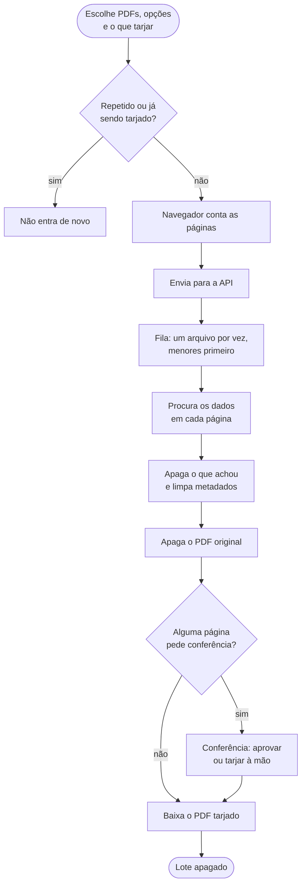
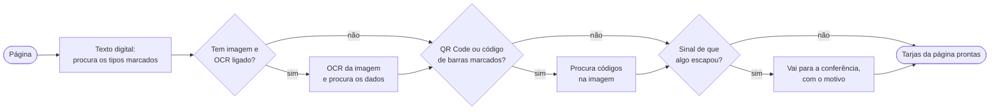

# Como funciona

O caminho de um PDF no Tarjador, do envio ao download. Na tela, o ícone de fluxo do cabeçalho mostra o mesmo processo num fluxograma com zoom.

## Visão geral

## 1. Escolher

Na tela principal a pessoa:

- **Marca o que tarjar.** O checklist "O que tarjar" tem 14 tipos em 6 grupos: documentos pessoais, contato, endereço, dados bancários, códigos na imagem e pessoa jurídica. Todos vêm marcados, menos o CNPJ. A escolha fica salva no navegador.
- **Liga as opções, se precisar:**
  - **Scan de baixa qualidade:** quando a linha cita "CPF", "RG", "e-mail" etc. e o número não foi lido, tarja a linha a partir do rótulo. Cobre mais do que o necessário, de propósito.
  - **PDF 100% digital (pular OCR):** não lê imagens. Fica bem mais rápido, mas dado dentro de imagem escaneada não é tarjado.
- **Seleciona ou arrasta os PDFs,** vários de uma vez, até 500 MB por envio.

Antes de enviar, o navegador:

- recusa arquivo repetido no mesmo envio, ou que já está sendo tarjado;
- conta as páginas de cada PDF (com o pdf.js, sem enviar nada) e avisa quando o envio passa de 300 páginas, com uma estimativa de tempo. É só aviso: o envio é aceito.

## 2. Enviar e esperar na fila

Ao clicar em **Tarjar**, os PDFs vão para a API como um **lote**. A API confere se cada arquivo é mesmo PDF (extensão e assinatura `%PDF-`), grava numa pasta temporária e põe na fila.

A fila tarja **um arquivo por vez**, escolhendo sempre o de **menos páginas**. Assim um documento curto não espera atrás de um processo de 300 páginas. Para o grande também não esperar para sempre, cada minuto na fila conta como 10 páginas a menos.

Dá para enviar mais PDFs enquanto outros são tarjados. Os lotes aparecem na barra **Tarjamentos**, à direita, com o andamento página a página, atualizado a cada segundo.

**Cancelar** interrompe na hora: os processos de OCR são encerrados e os arquivos do lote são apagados.

## 3. Tarjar

Para cada página, a API roda as camadas de detecção e depois apaga o que encontrou:

Os detalhes de cada camada estão em [Motor de detecção](Motor-de-deteccao.md). As páginas de um arquivo são analisadas em paralelo, em até 4 processos.

Ao terminar o arquivo, o PDF original é apagado do disco.

## 4. Conferir

Cada arquivo pronto mostra um selo: **Sem pendências**, **N para conferir** ou **Conferido**.

Uma página vai para a conferência quando:

- cita um tipo de dado mais vezes do que o número de tarjas daquele tipo (ex.: "CPF" aparece 4 vezes e só saiu 1 tarja);
- é uma imagem e o OCR não achou nada;
- uma tarja tem motivo para dúvida: OCR com confiança baixa, CPF com dígito inválido ou incompleto, endereço (detectado por heurística), valor achado pelo rótulo vizinho, ou tarja larga do modo Scan de baixa qualidade.

Em **Abrir conferência**, cada página aparece com o motivo e um check **Aprovada**. Em **Ver página**:

- a imagem é da página **já tarjada**, nunca do original;
- **Anterior** e **Próxima** percorrem todas as páginas, e **Próxima pendência** pula direto;
- **Tarjar à mão**: arrastar sobre a página desenha tarjas, que dá para desfazer antes de aplicar. Ao **Aplicar**, o apagamento é definitivo, igual ao automático;
- **Página aprovada** marca a página como conferida.

As aprovações são só para controle da pessoa: não mudam o PDF e ficam salvas na aba do navegador.

## 5. Baixar

**Baixar PDF tarjado** pergunta o que fazer:

- **Baixar e concluir:** baixa, tira o arquivo dos tarjamentos e registra no **histórico** (nome, páginas, tarjas e tipos; nunca o conteúdo). Quando todos os arquivos do lote são concluídos, o lote é apagado na API.
- **Só baixar:** baixa e mantém o arquivo nos tarjamentos, para conferir ou baixar de novo.

O PDF baixado se chama `<nome original>_TARJADO.pdf`.

## Quanto tempo leva

Depende quase só do OCR. Na máquina de desenvolvimento, um PDF digitalizado de 16 páginas cheias de texto levou cerca de 3,5 minutos, uns 13 segundos por página. PDFs digitais, sem imagens, levam segundos. A opção **PDF 100% digital** pula o OCR.
